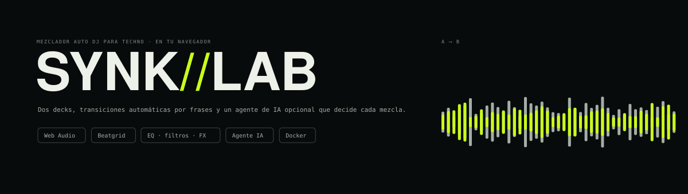
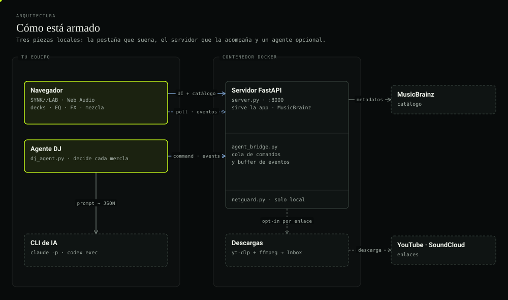
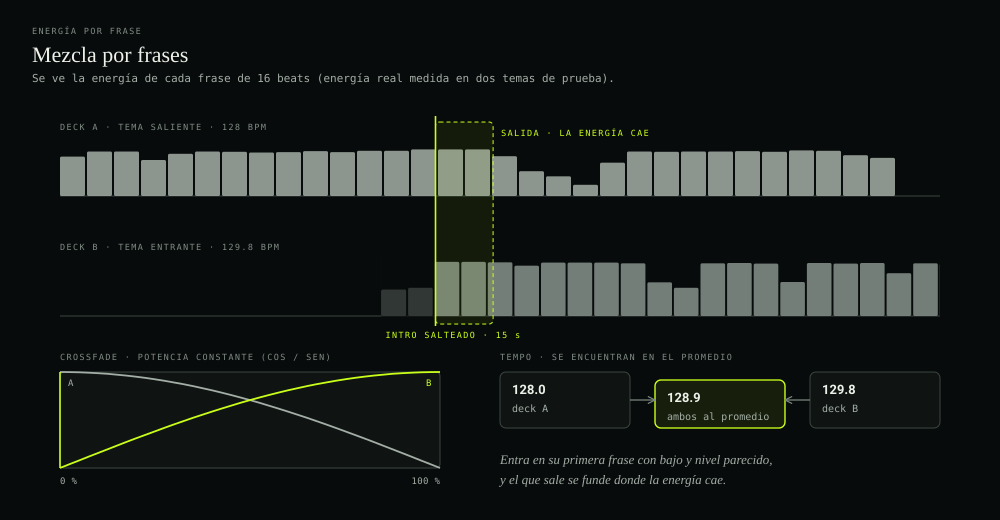
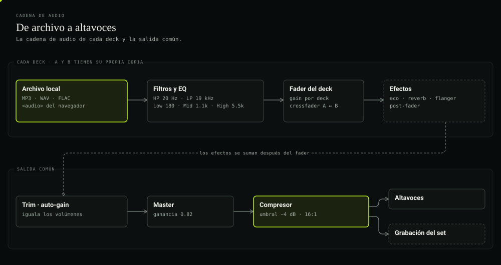

<div align="center">



**Mezclador Auto DJ para techno que corre en tu navegador.**<br>
Dos decks reales de Web Audio, transiciones automáticas por frases y un agente de IA opcional que decide cada mezcla.

[Instalar](#instalación-en-un-comando) · [Qué hace](#qué-hace) · [Cómo funciona](#cómo-funciona) · [Diagramas interactivos](https://fer336.github.io/techno-synklab/arquitectura.html) · [API del agente](AGENT_API.md)

</div>

---

## Qué hace

SYNK//LAB es un prototipo local con diseño *Dark Lime Cyberpunk*, hecho con HTML, CSS y JavaScript nativos y un servidor FastAPI. Importas tus propios archivos de audio y el Auto DJ los mezcla de forma continua.

- **Dos decks de Web Audio** con crossfader, filtros pasa-altos y pasa-bajos, EQ de 3 bandas, eco, reverb, flanger, pads de rendimiento (reverb throw, brake, sweep), loops por beats, hot cues, beat jump, nudge, EQ kill, key lock y grabación del master.
- **Mezcla automática con criterio:** cada transición aplica un EQ automático (intercambio de graves o mezcla) y un efecto, más el barrido de filtro y la aproximación de tempo.
- **Alineación de golpes:** estima la rejilla del bombo de cada tema (BPM refinado y fase), empieza el tema entrante en la próxima barra del saliente y lo corrige en fase con pequeños ajustes de velocidad.
- **Tempo en el promedio:** si dos temas tienen BPM cercanos (por ejemplo 127 y 129), ambos se encuentran en el promedio (128).
- **Mezcla por frases:** el tema que entra salta su intro y el que sale se funde donde la energía cae, sin esperar al final. [Ver cómo](#mezcla-por-frases).
- **Preparación del set:** al iniciar, analiza cada archivo (BPM, rejilla, tonalidad estimada, peso del bajo, intro) y ordena el set por BPM, armonía (Camelot) y similitud de bajo.
- **Agente de IA opcional:** una CLI donde ya tienes sesión (Claude o Codex) decide duración, EQ, efecto y filtro de cada transición. No usa claves de API. [Ver flujo](#flujo-del-agente).
- **Catálogo:** búsqueda de metadatos en MusicBrainz (por texto, no por sonido), sellos y lanzamientos.
- **Una URL por servicio:** `/` (Auto DJ), `/detector-bpm-tonalidad`, `/planificador-sets-techno`, `/sellos-techno` y `/descubrir-musica-techno` abren la misma app en su herramienta, cada una con su título, descripción, canonical, datos estructurados y un único `<h1>`. El servidor publica `sitemap.xml` y `robots.txt` (`seo.py`); el dominio canónico es una constante en ese módulo.
- **Descarga opcional** de enlaces de YouTube o SoundCloud con `yt-dlp` y `ffmpeg`, siempre por orden tuya y solo en local.
- **Versión móvil** (hasta 770 px): interfaz propia con cinco pantallas (Mezcla, Cola, Importar, Agente y Ajustes) pensada para usarse con una mano. Durante una mezcla se ven los dos decks a la vez. Descubrir, Analizador, Sets y Sellos siguen disponibles desde *Ajustes › Más herramientas*.
- Sin cuentas ni base de datos. El set se guarda en el navegador y se exporta como JSON o CSV.

> Los archivos de audio se procesan **en tu navegador** y nunca se suben a ningún servidor.

## Instalación en un comando

Requiere [Docker](https://docs.docker.com/get-docker/), `curl` y `tar`:

```bash
curl -fsSL https://raw.githubusercontent.com/fer336/techno-synklab/main/install.sh | sh
```

Construye la imagen con todas las dependencias (`ffmpeg` y `yt-dlp` incluidos), la inicia y deja la app en **http://localhost:8000**. Lo descargado va a `~/SynkLab/Inbox`.

| Variable | Para qué sirve | Valor por defecto |
|---|---|---|
| `SYNKLAB_PORT` | Puerto en `127.0.0.1` | `8000` |
| `SYNKLAB_INBOX` | Carpeta de las descargas | `~/SynkLab/Inbox` |
| `SYNKLAB_NAME` | Nombre del contenedor | `synklab` |
| `MUSICBRAINZ_USER_AGENT` | Tu contacto para MusicBrainz (recomendado) | genérico |

Ejemplo: `curl -fsSL … | SYNKLAB_PORT=8010 sh`. Para quitarlo: `curl -fsSL … | sh -s -- uninstall` (la carpeta Inbox se conserva).

También se puede usar desde un clon: `docker compose -f docker-compose.dev.yml up -d`.

<details>
<summary>Sin Docker (ejecución local)</summary>

```bash
python -m venv .venv
source .venv/bin/activate
pip install -r requirements.txt
# opcional, para el botón de descarga (necesita ffmpeg en el sistema):
pip install -r requirements-download.txt
export MUSICBRAINZ_USER_AGENT='SynkLab/0.2 (tu-contacto@example.com)'
uvicorn server:app --reload
```

Abre http://localhost:8000. Sin `yt-dlp` y `ffmpeg` el botón de descarga queda deshabilitado.

</details>

## Cómo se usa

1. Abre la app, importa tus temas y pulsa **Iniciar Auto DJ**. Con **Analizar y ordenar todo antes de empezar** activado (viene marcado), antes de arrancar se analiza y ordena el set.
2. Ajusta lo que quieras: **Duración de transición**, EQ, efecto, **Sincronizar tempo y golpes** y **Mezclar por frases**.
3. **(Opcional) Agente de IA.** Marca **Permitir control por agente** en el panel Auto DJ y, en otra terminal:

```bash
synklab-agent --provider claude --start --style "hipnótico, mezclas largas"
```

`synklab-agent` lo crea el instalador y necesita `python3` y la CLI con sesión iniciada. Desde un clon: `python3 dj_agent.py …`.

| `--provider` | Qué usa |
|---|---|
| `claude` | `claude -p` (suscripción de Claude Code) |
| `codex` | `codex exec` (suscripción de ChatGPT) |
| `rules` | Sin IA: reglas aleatorias (también es el respaldo si la IA tarda) |

> Con el agente activo, la duración (`fade`) que elige la IA tiene prioridad sobre el selector **Duración de transición** en esa mezcla.

## Cómo funciona

> 🖱️ **[Abre la versión interactiva](https://fer336.github.io/techno-synklab/arquitectura.html)**: toca los bloques para ver sus conexiones y qué hace cada módulo, recorre el flujo del agente paso a paso y mueve la mezcla con un deslizador.
>
> **¿Por qué hay dos versiones?** GitHub no ejecuta JavaScript dentro del README, así que aquí los diagramas son SVG animados (se ven solos, pero no responden al clic). La versión interactiva es una página estática (`docs/arquitectura.html`) publicada con **GitHub Pages** desde la carpeta `docs/` de la rama `main`: se actualiza sola con cada push y no necesita servidor propio. También puedes abrirla sin conexión: `python3 -m http.server -d docs 8099` y entra a http://localhost:8099/arquitectura.html.

### Arquitectura

<p align="center"></p>

- El **navegador** concentra todo el audio. Es la única pieza que suena.
- El **servidor FastAPI** sirve la app, consulta MusicBrainz (1 consulta por segundo, con caché de 6 horas) y hace de **puente** entre el agente y la pestaña: guarda una cola de comandos y un buffer de eventos.
- El **agente DJ** es un proceso aparte, opcional, que corre en tu equipo y no necesita claves de API.
- Las **descargas** (`yt-dlp` + `ffmpeg`) solo ocurren si lo pides por enlace.

### Flujo del agente

<p align="center"></p>

1. Unos 70 segundos antes del punto de salida, la pestaña emite `track_ending`.
2. El agente, que espera por *long-poll*, recibe el evento.
3. Pide el estado (decks, cola, datos del siguiente tema). El servidor retransmite el comando y la pestaña responde.
4. Arma un *prompt* con la pareja de temas: diferencia de BPM, compatibilidad de tonalidad (Camelot), peso del bajo y si los golpes se pueden alinear.
5. La IA responde **solo un JSON**: `fade`, `eq`, `fx`, `fx_amount`, `filter` y, opcionalmente, `next_id`.
6. El agente envía `plan_transition` con `from_id`. Si la mezcla ya empezó, el mixer **rechaza el plan por tardío** y no se aplica a otra pareja de temas. Si quedan menos de unos 30 segundos, el agente usa reglas sin esperar a la IA.
7. El mixer ejecuta la mezcla alineada y avisa `transition_start`.

La lista completa de acciones y eventos está en [`AGENT_API.md`](AGENT_API.md).

### Mezcla por frases

<p align="center"></p>

Con *Mezclar por frases* activado, cada tema recibe un **mapa de energía por frase de 16 beats** (necesita una rejilla confiable):

- **Salida:** el tema actual se funde en la primera frase, pasada la mitad del tema, donde su energía cae (un *breakdown* o el cierre). No espera al final.
- **Entrada:** el tema nuevo empieza en su primera frase con el bajo activo y un nivel a menos de 3 dB del que sale. Así se salta el intro.
- **Tempo:** si los BPM están a menos de un 6 % (contando doble y mitad), ambos decks se encuentran en el promedio; si no, el entrante sigue al saliente hasta ±12 %.
- **Crossfade de potencia constante:** el deck A recibe cos θ y el B sen θ, así el volumen total se mantiene parejo. El intercambio de graves ocurre entre el 45 % y el 60 % de la mezcla.

Sin rejilla confiable, cada tema empieza desde el principio y suena hasta el final, como antes.

### Cadena de audio

<p align="center"></p>

Cada deck tiene su propia copia de la cadena. Los efectos se envían **después del fader**, así sus colas sobreviven al crossfade. La salida común pasa por un compresor (umbral −4 dB, ratio 16:1) y se duplica en una grabación del set.

## Despliegue en producción (Portainer)

El proyecto sigue el estándar de [`INFRASTRUCTURE.md`](INFRASTRUCTURE.md) (vía `app`, perfil `A`) y se publica en **https://synklab.qeva-ai.com**:

- Se despliega **solo al crear una release** `vX.Y.Z`: el pipeline prueba, publica una imagen inmutable en `ghcr.io/fer336/techno-synklab`, fija el tag en `docker-compose.yml`, dispara el webhook de Portainer y verifica `/health` y `/version`.
- La configuración de runtime es **un único secret** (`techno_synklab_env`); la interfaz no tiene variables de build.
- En modo hospedado el agente de IA y las descargas quedan deshabilitados (son locales por diseño).
- Paso a paso, rollback y contenido del secret: [`docs/DEPLOYMENT.md`](docs/DEPLOYMENT.md).

## Seguridad y privacidad

- Los endpoints del agente (`/api/agent/*`) y de descarga **solo aceptan clientes locales**, con comprobación de `Host` y `Origin` contra DNS rebinding y CSRF.
- En Docker, el instalador publica el puerto solo en `127.0.0.1`. Dentro de la imagen, `SYNKLAB_IN_CONTAINER=1` permite la dirección del puente de Docker. **No publiques el puerto en otras interfaces** ni compartas su red con contenedores no confiables.
- La descarga es opcional por enlace, acepta únicamente HTTPS de YouTube y SoundCloud, y nunca lee las cookies del navegador salvo que lo configures (`SYNKLAB_YTDLP_COOKIES_BROWSER`).
- Descarga solo contenido que tengas derecho a usar.
- El servidor consulta YouTube oEmbed solo para hosts exactos permitidos.

## Estructura del proyecto

```text
.
├── server.py            # FastAPI: sirve la app, MusicBrainz, oEmbed
├── agent_bridge.py      # puente agente ⇄ pestaña (cola de comandos, eventos)
├── downloader.py        # descargas opcionales con yt-dlp
├── netguard.py          # comprobaciones de "solo local"
├── config.py            # carga de configuración (secret > .env) y /health, /version
├── dj_agent.py          # agente DJ (claude / codex / reglas)
├── static/              # index.html + mixer.js (audio) + mobile.js/css (interfaz móvil)
├── docs/                # diagramas interactivos y SVG animados
│   └── tools/           # generador de los diagramas
├── tests/               # pruebas del guard de red
├── Dockerfile · install.sh
├── docker-compose.yml   # stack de producción (Portainer) · docker-compose.dev.yml: desarrollo local
├── INFRASTRUCTURE.md · infra.project.yml · AGENTS.md · .github/workflows/
└── AGENT_API.md         # referencia de la API del agente
```

## Límites conocidos

- El BPM por navegador es una **heurística**: puede confundir mitad y doble tempo y fallar en ritmos raros. Verifícalo de oído.
- La tonalidad (Camelot) es una **estimación** y el techno suele ser atonal; con confianza baja pesa menos en el orden.
- La rejilla asume tempo constante y un bombo claro. No es un motor de *beatmatching* profesional.
- YouTube y SoundCloud se mezclan **solo por volumen**: su audio no se puede enrutar a Web Audio, así que no tienen EQ, filtros, efectos, loops ni sincronización.
- No hay identificación por huella acústica ni búsqueda de similitud sonora: la relevancia del catálogo es la de MusicBrainz sobre texto.
- No hay estimación de frases en temas de tempo variable ni integración con la API oficial de Beatport.

## Desarrollo

```bash
python3 -m unittest discover -s tests        # pruebas del guard de red
python3 docs/tools/build_diagrams.py .       # regenera docs/img/*.svg y docs/arquitectura.html
```

Tras regenerar, haz commit de `docs/` y push a `main`: GitHub Pages republica la página interactiva en menos de un minuto. Los SVG del README se actualizan con el mismo commit.

Los diagramas siguen la gramática editorial de [diagram-design](https://github.com/cathrynlavery/diagram-design) (MIT): sin sombras, bordes finos, conectores ortogonales y uno o dos nodos de acento.

## Licencia

[MIT](LICENSE). La licencia cubre el código de este repositorio; `yt-dlp`, `ffmpeg` y el resto de dependencias mantienen la suya, y el contenido que descargues o importes es responsabilidad tuya.

<details>
<summary>Scrapling (ejemplo opcional)</summary>

`requirements-scrapling.txt` y `scrapling_adapter.py` son **solo un ejemplo para sitios autorizados**. Nada en este proyecto usa Scrapling contra Beatport, descarga previews de Beatport, evita restricciones técnicas ni extrae datos de Beatport para entrenar IA. Respeta los *robots* y los contratos de cada fuente.

</details>

## Notas operativas

- MusicBrainz exige un `User-Agent` real y un máximo de ~1 consulta por segundo. El servidor las serializa y cachea 6 horas (un solo proceso). Con varios *workers*, mueve el límite a Redis.
- No aparecen temas, análisis ni porcentajes de similitud inventados.
